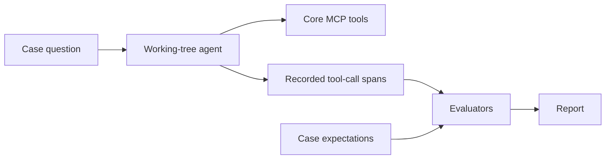

# Understanding agent evaluations

A prompt or model change can improve one request and break another. Trying a few questions in chat helps uncover
problems, but it leaves little evidence for comparing changes later. Evaluations turn those questions and expectations
into repeatable experiments.

An **eval case** gives the agent a task and defines how to judge its behavior. Each attempt produces an answer and a
record of tool use; **evaluators** apply checks to that evidence. A dataset collects cases, and a report records the
results of running them. A **baseline** is an earlier report chosen as the reference for a comparison.

For practical steps, see [How to benchmark prompt and model changes](../guides/evals.md) or
[How to add an evaluation case](../guides/add-eval-case.md). This page explains what the Orchestrator Agent benchmark
can tell us, and where its evidence stops.

## Why ordinary tests and evals answer different questions

Ordinary tests can verify a guard, parser or protocol adapter with controlled inputs and model responses. They help
establish that the code behaves as designed. An eval using a real model asks whether that model, the instructions and
the available tools work together on representative requests.

Changing the model can change which tools it chooses. Changing a tool description or domain instructions can change
how it interprets the same question. Even with unchanged code, a model may take a different route on another attempt.
An evaluation therefore gives evidence about behavior under stated conditions, rather than a guarantee for every
future conversation.

## Tool use, answers and completed tasks

For a request such as “How many products are there?”, three things can be judged separately: whether the agent asks
the appropriate tool for a product count, whether it reports the correct number, and whether that answers the user's
actual need. A correct tool call can still be followed by an incorrect answer. A plausible answer can also conceal a
wrong query.

The bundled benchmark focuses on the first layer: the **trajectory**, meaning which tools were called and in what
order, together with selected arguments. It runs the working-tree agent in-process against a live Core MCP server
with seeded data. OpenTelemetry spans supply the tool-call evidence for the evaluators.

The final answer is retained in saved reports, but the current dataset does not grade it. Likewise, choosing a workflow
tool would not by itself prove that a person approved a form or that a workflow completed. Those require different
checks and evidence.

## Why this benchmark checks trajectories

Many requests have useful, observable constraints. A count should use aggregation rather than retrieving rows to
count them. A subscription identifier should pass through unchanged. An off-topic request should not call inventory
tools. Code-based evaluators make such expectations explicit and their failures inspectable.

The benchmark combines exact tool sequences, partial-credit sequence matches, selected argument checks and a call
budget. Trajectory and argument checks omit failed tool-call attempts by default, while the budget counts them.
For example, a product-count case can expect `aggregate` with `entity_type: PRODUCT`. That is stronger than
checking whether the answer contains the word “products”, but weaker than verifying the count against the database.
The [evaluator reference](../reference/evals.md#evaluators) defines the checks precisely.

There is a tradeoff in prescribing a route. Exact matching is useful when an extra action would be wrong, such as
exporting without a request. It can also reject a valid alternative. In-order matching gives partial credit when the
expected calls occur in sequence, but extra calls still reduce the score. A low trajectory score can therefore mean
an inefficient route, an incorrect route, or an expectation that is too narrow.

[Anthropic's discussion of agent evals](https://www.anthropic.com/research/demystifying-evals-for-ai-agents) makes the
case for grading outcomes where possible and reviewing whether graders reject valid solutions. Here, trajectory
checks are a bounded measure of tool-use behavior, not a substitute for outcome checks. Human review connects their
scores to what users actually need.

## What makes the dataset useful

A useful dataset represents work people need the agent to do, including observed failures. Positive cases exercise
wanted behavior; negative cases check that the agent refrains when an action is inappropriate. Without both, a suite
can reward an agent that searches or exports indiscriminately.

The bundled golden set is hand-curated against deterministic seed data. Each case records its failure-mode tags and
a curation note explaining the expected route. These notes let a reviewer distinguish an intentional requirement from
an accidental preference for the route a previous model happened to take.

Generated questions can help draft variations, but they still need review against the task and seed data. Copying an
agent's observed route into an expectation without checking it can preserve its mistakes. The important property of a
golden set is that its expectations are justified, regardless of how its first draft was produced.

A small suite can protect important behavior while missing whole classes of requests. High scores on these cases say
little about a new domain or a different inventory unless those needs are represented too.

## What comparisons can establish

A baseline makes changes visible by case. Keeping the data, tools and configuration fixed helps attribute differences
to the prompt or model being changed. Model comparisons deliberately change the model; prompt comparisons hold it
fixed. Both need the same tasks and checks to make the result meaningful.

The runner compares matching scores and assertions against a saved report. Its tolerance allows small score drops,
and a separate aggregate floor can reject broadly poor results. Neither gate means that every case passed: a baseline
may already contain failures, and an average can conceal a serious individual failure. Cases missing from one side do
not establish an improvement or a regression.

Variation between attempts is another limit. Repeated runs help reveal whether a failure is persistent or intermittent,
but the current runner performs one attempt per case and uses a fixed tolerance rather than statistical significance
testing. A small difference in one run is weak evidence for choosing a model. Consistent behavior on important cases,
reviewed answers and operational requirements matter alongside the scores.

Baseline updates are consequently review decisions. Automatically replacing a baseline after a failure would erase
the comparison that made the failure visible. A reviewed update records a deliberately accepted expectation.

## What this benchmark leaves open

The current suite covers single-turn search, aggregation, lookup and export behavior. It does not establish final-answer
correctness, multi-turn reliability, workflow form filling or approval, or successful execution through a client and its
protocol adapter. Those need additional evals, integration tests or manual acceptance checks appropriate to the claim.

The call budget constrains tool use, but the gates are not cost or latency acceptance criteria. The suite also has no
separate comprehensive prompt-rule evaluator or support for declaring multiple equally valid golden routes per case.

Production observations remain useful even after a benchmark passes. Traces can expose requests and failure modes
that the dataset lacks; reviewed examples can then become future cases. [Tracing and observability](observability.md)
explains that feedback loop. Pydantic's [agentic evaluator documentation](https://pydantic.dev/docs/ai/evals/evaluators/agentic/)
describes the underlying grading tools.
