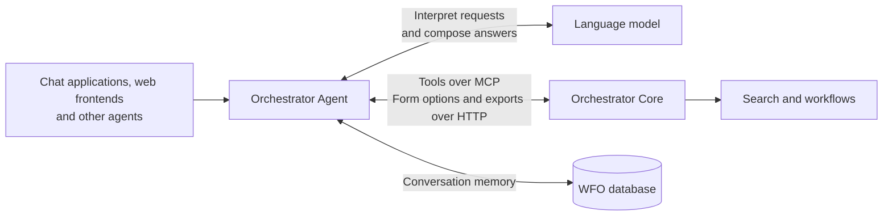

# How the agent fits on top of Orchestrator Core

The Orchestrator Agent connects natural-language requests to the data and workflows in WFO. It combines a language
model of your choice with the tools provided by Orchestrator Core through MCP (Model Context Protocol). The model
interprets the request and chooses tools; Core searches the data, validates workflow inputs and runs workflows.
The agent brings these parts together and returns an answer to the person or system that asked.

## Orchestrator Core provides the knowledge and operations

The agent uses the same subscriptions, products, processes and workflows that your orchestrator already manages.
Search and indexing belong to Orchestrator Core, as do the rules for validating and running workflows. This keeps
the agent connected to your existing domain without maintaining a second search index or its own version of your
workflow logic.

Core makes these operations available as tools through its MCP server. Each tool describes what it does and how to
use it, so the model can choose an operation that fits the question. The agent's instructions describe its purpose;
the knowledge of how to search your orchestrator stays with Core's tools.

Core is the only MCP server configured by the agent itself. AG-UI callers can also supply frontend tools through
their adapter, as described in the [endpoint reference](../reference/endpoints.md#ag-ui). To bring in another system,
[expose it as a tool](https://workfloworchestrator.org/orchestrator-core/reference-docs/mcp/#extending) in your
orchestrator, or give it an agent of its own and let a planner combine both answers. See
[Connect another system through a planner](https://workfloworchestrator.org/learn/orchestrator-agent/integrations/connect-service/).

For example, a question about active subscriptions becomes a search through Core. Core returns matching records,
and the agent presents them with an explanation. Tables and charts are built from the returned data by the agent,
so the model does not need to reproduce each row or number in its answer.

The [Core MCP reference](https://workfloworchestrator.org/orchestrator-core/reference-docs/mcp/) describes the tools;
the [plugin reference](../reference/plugins.md) lists the plugins that make up the agent's [capabilities](#capabilities).

## The language model interprets the request

The model connects the user's words to the available tools and uses their results to compose an answer. Changing
the model can change how requests are interpreted, which tools are chosen and how reliably tasks are completed,
while Core remains responsible for the underlying operations. A different model can improve some tasks and perform
worse on others. [Evaluations](evaluation.md) compare the agent's tool choices and arguments on a shared set of
questions, helping you assess a model change before relying on it in your environment.

You can use a hosted model or one running in your own environment. This choice also determines where the request,
conversation history and tool results read by the model are processed. A model hosted outside your network receives
that information, which may include sensitive customer or operational data. Depending on your privacy requirements,
sending it to an external provider may be unsuitable. Whether the provider retains that data or can use it for model
training depends on the service, settings and agreement; using a hosted model does not automatically mean that your
data is used for training. Those terms matter when deciding whether a provider is appropriate for your data.
A self-hosted model lets you keep that processing within your infrastructure. See
[Change the language model](../guides/own-llm.md) for supported connections and setup.

The same applies to tracing. With Langfuse or another tracing backend enabled, prompts and tool results are also sent
there. See [Tracing and observability](observability.md).

### How a question becomes a search

Core's tool descriptions guide the model to treat an identifier in a question as a search key, discover the matching field and filter on it
with `like`, a case-insensitive wildcard match for a known substring. That filter does not itself tolerate typos;
fuzzy retrieval ranks approximate text matches. If no field clearly matches, the tools can rank results instead. With
embeddings enabled in Orchestrator Core, it also picks a retriever per question: hybrid for identifiers and names,
semantic for descriptive questions, and fuzzy otherwise.

The model cannot reliably infer conventions specific to your organisation, such as which field holds a circuit
code or what an abbreviation of a product means. Add that knowledge to the system prompt through
[domain context](../guides/domain-context.md).

## The database stores the conversations

The agent also needs a direct connection to the WFO PostgreSQL database. It stores conversation history and state,
including an open workflow form, so a later message can continue the same conversation. For example, answering the
next form question requires remembering the workflow and the answers already supplied.

These connections serve different purposes: MCP provides access to WFO operations, HTTP supplies form options and
export files, and the database stores the
agent's conversation memory. The database connection does not give the model a SQL interface to your inventory.
The storage details are in [Conversation persistence](../reference/runtime.md#conversation-persistence).

## Capabilities extend the model and its tools

Orchestrator Core supplies the tools; capabilities shape how the model uses them. A capability is the extension unit
of pydantic-ai, the framework the agent runs on. Each one can contribute instructions for the model, extra tools, and
hooks that run around a model request or a tool call. The agent uses three kinds:

- **Plugins.** A [plugin](../reference/plugins.md) is a Markdown file: a prompt plus a few lines of frontmatter. The
  prompt tells the model how to do one job, and the frontmatter names the tools the plugin owns and how to render their
  results, as a table, a chart or a download link. The built-in plugins are search, aggregate, entity, export and
  workflow.
- **Guards.** Guards are rules written in Python that constrain the model and its tools: the filter path guard, the
  deferred tool gate, history trimming and, wherever the form-fill skill runs, the write tool gate. See
  [Plugins and guards](../reference/runtime.md#plugins-and-guards).
- **The form-fill skill.** This Python capability intercepts messages before they reach the model and guides the
  person through a workflow form, one page at a time. See [Workflow forms](../reference/runtime.md#workflow-forms).

A plugin is either always on or deferred, controlled by `defer_loading` in its frontmatter. The model sees an
always-on plugin's instructions and tools from the start. A deferred plugin stays hidden until the model calls the
`load_capability` tool to load it. All built-in plugins are always on.

Not every interface gets every capability. A2A, `/v1` and AG-UI share an agent that includes the form-fill skill, so
they get the workflow plugin, the skill and the write tool gate. The agent's `/mcp` endpoint gets a separate agent
with the remaining plugins and guards. The A2A agent card also advertises each plugin as a skill, unless its
frontmatter sets `advertise: false`.

Don't confuse these with the `capabilities` field of the A2A agent card. That field lists protocol features such as
streaming and is unrelated.

## Different ways to reach the same agent

The agent can sit behind an existing chat application, become part of your own application, or work alongside other
agents. These interfaces connect different kinds of callers to the same WFO operations:

- **A chat application**, such as LibreChat, gives people a place to ask questions and read answers. The agent
  appears as a model in the application, using an OpenAI-compatible chat interface. See
  [Connect LibreChat](../guides/librechat.md).
- **Another agent** can delegate the WFO part of a larger task through A2A. A planner could combine
  an answer about WFO subscriptions with information from an inventory agent responsible for NetBox. See
  [Connect another agent over A2A](../guides/a2a-planner.md).
- **Your own web frontend** can display the conversation and results as part of your application. AG-UI carries
  the events the frontend needs to show the agent's progress and answers. See
  [AG-UI endpoint reference](../reference/endpoints.md#ag-ui).
- **An MCP client** can use the agent as a tool that answers WFO questions in plain language. This lets an assistant
  in another application ask the agent for help. See [Use the agent with MCP](../guides/mcp-clients.md).

There are two distinct MCP connections: the agent calls Core's tools, and an external client can call the agent's
own tools. Connecting directly to Core puts the calling client in charge of choosing WFO operations. Connecting to
the agent lets it interpret the question and coordinate those operations. The
[endpoint reference](../reference/endpoints.md) describes each interface and its supported features.

The same choice applies to another agent that needs WFO data. Delegating to the Orchestrator Agent over A2A is
usually better than giving that agent the MCP server of Core as a toolset, because a direct connection gets only the
raw tools. It misses what the Orchestrator Agent adds on top:

- the [plugins](../reference/plugins.md), which tell the model how to search, aggregate, look up, export and start
  workflows, and map results to tables, charts and export metadata. Download delivery currently requires
  [AG-UI](../reference/endpoints.md#export-delivery);
- the guards, such as the filter path guard that stops the model from guessing filter paths, and history trimming;
- the [form-fill skill](../reference/runtime.md#workflow-forms), which walks a workflow form with the person and
  starts the workflow only after approval. Without it, the model can call the write tools of Core directly, see
  [Read tools and write tools](../reference/runtime.md#read-tools-and-write-tools);
- your [domain context](../guides/domain-context.md).

A direct connection still makes sense when the other agent's model should make all the choices itself, for example
in a harness where a person approves every tool call.

## Why workflow starts need approval

Our design position is that the language model in an agent working with WFO should not have direct access to
operations that create, change or delete services or start, resume or abort workflows. Answering a question and changing a service have different
consequences. A model can misunderstand a request or choose the wrong workflow, so it should propose changes for
a person to approve before they are carried out.

The model can select a workflow. Where the form-fill skill runs, on A2A, the OpenAI-compatible `/v1` endpoint
that LibreChat uses, and AG-UI, Core's three workflow write tools are hidden from the model.
A separate form-handling path
collects the person's answers, has Core validate them and asks for explicit approval before starting the workflow.
This is the agent's human-in-the-loop (HITL) boundary. Core continues to own the validation and execution; the agent
helps the person through the interaction.

This restriction applies to the model's control over services and workflows. The service itself still writes
conversation history and query results, and the form handler can start a workflow after receiving approval.
The calling client is responsible for collecting that approval from a person and forwarding it faithfully.

The agent's own MCP endpoint runs without the form-fill skill, so this boundary does not apply there: its model
can call Core's write tools directly, without a built-in approval step. See
[Read tools and write tools](../reference/runtime.md#read-tools-and-write-tools).

This requires a client that can present questions and approval: LibreChat, an A2A planner with support for human
input, or an AG-UI frontend that supports interrupts. The MCP interface does not offer workflow forms. See
[Start workflows from chat](https://workfloworchestrator.org/learn/orchestrator-agent/use-cases/workflows-from-chat/) for setup and
[Runtime behaviour](../reference/runtime.md#workflow-forms) for the form-handling details.

The boundary covers only Core's three workflow write tools, which the gate hides by name. A custom tool you add to
Core, a frontend tool supplied over AG-UI, or another agent the planner calls gets no approval step from this
form-fill skill, so build approval into each
integration or keep those tools read-only. See
[Connect another system through a planner](https://workfloworchestrator.org/learn/orchestrator-agent/integrations/connect-service/) and
[Run a companion agent with docker-agent](https://workfloworchestrator.org/learn/orchestrator-agent/integrations/create-agent/).
