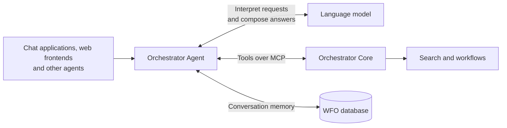

# How the agent fits into WFO

The Orchestrator Agent connects natural-language requests to the data and workflows in WFO. It combines a language
model of your choice with the tools provided by Orchestrator Core through MCP (Model Context Protocol). The model
interprets the request and chooses tools; Core searches the data, validates workflow inputs and runs workflows.
The agent brings these parts together and returns an answer to the person or system that asked.

## Orchestrator Core provides the knowledge and operations

The agent uses the same subscriptions, products, processes and workflows that your orchestrator already manages.
Search and indexing belong to Orchestrator Core, as do the rules for validating and running workflows. This keeps
the agent connected to your existing domain without maintaining a second search index or its own version of your
workflow logic.

Core makes these operations available as tools through its MCP server. Each tool describes what it does and how to
use it, so the model can choose an operation that fits the question. The agent's instructions describe its purpose;
the knowledge of how to search your orchestrator stays with Core's tools.

For example, a question about active subscriptions becomes a search through Core. Core returns matching records,
and the agent presents them with an explanation. Tables and charts are built from the returned data by the agent,
so the model does not need to reproduce each row or number in its answer.

The [Core MCP reference](https://workfloworchestrator.org/orchestrator-core/reference-docs/mcp/) describes the tools;
the [plugin reference](../reference/plugins.md) lists the agent's capabilities.

## The language model interprets the request

The model connects the user's words to the available tools and uses their results to compose an answer. Changing
the model can change how requests are interpreted, which tools are chosen and how reliably tasks are completed,
while Core remains responsible for the underlying operations. A different model can improve some tasks and perform
worse on others. [Evaluations](evaluation.md) compare the agent's tool choices and arguments on a shared set of
questions, helping you assess a model change before relying on it in your environment.

You can use a hosted model or one running in your own environment. This choice also determines where the request,
conversation history and tool results read by the model are processed. A model hosted outside your network receives
that information, which may include sensitive customer or operational data. Depending on your privacy requirements,
sending it to an external provider may be unsuitable. Whether the provider retains that data or can use it for model
training depends on the service, settings and agreement; using a hosted model does not automatically mean that your
data is used for training. Those terms matter when deciding whether a provider is appropriate for your data.
A self-hosted model lets you keep that processing within your infrastructure. See
[Use your own LLM](../guides/own-llm.md) for supported connections and setup.

## The database keeps the conversation going

The agent also needs a direct connection to the WFO PostgreSQL database. It stores conversation history and state,
including an open workflow form, so a later message can continue the same conversation. For example, answering the
next form question requires remembering the workflow and the answers already supplied.

These connections serve different purposes: MCP provides access to WFO operations, while the database stores the
agent's conversation memory. The database connection does not give the model a SQL interface to your inventory.
The storage details are in [Conversation persistence](../reference/runtime.md#conversation-persistence).

## Different ways to reach the same agent

The agent can sit behind an existing chat application, become part of your own application, or work alongside other
agents. These interfaces connect different kinds of callers to the same WFO capabilities:

- **A chat application**, such as LibreChat, gives people a place to ask questions and read answers. The agent
  appears as a model in the application, using an OpenAI-compatible chat interface. See
  [Connect LibreChat](../guides/librechat.md).
- **Another agent** can delegate the WFO part of a larger task through A2A (Agent-to-Agent). A planner could combine
  an answer about WFO subscriptions with information from an inventory agent responsible for NetBox. See
  [Use the agent from an A2A planner](../guides/a2a-planner.md).
- **Your own web frontend** can display the conversation and results as part of your application. AG-UI carries
  the events the frontend needs to show the agent's progress and answers. See
  [Build a frontend with AG-UI](../guides/ag-ui.md).
- **An MCP client** can use the agent as a tool that answers WFO questions in plain language. This lets an assistant
  in another application ask the agent for help. See [Use MCP clients](../guides/mcp-clients.md).

There are two distinct MCP connections: the agent calls Core's tools, and an external client can call the agent's
own tools. Connecting directly to Core puts the calling client in charge of choosing WFO operations. Connecting to
the agent lets it interpret the question and coordinate those operations. The
[endpoint reference](../reference/endpoints.md) describes each interface and its supported features.

## The agent needs approval before starting workflows

Our design position is that the language model in an agent working with WFO should not have direct access to
operations that create, change or delete services or start, resume or abort workflows. Answering a question and changing a service have different
consequences. A model can misunderstand a request or choose the wrong workflow, so it should propose changes for
a person to approve before they are carried out.

The model can select a workflow. On every interface, automatically discovered Core tools must be explicitly declared read-only.
Core's built-in workflow write tools stay hidden during automatic discovery, and AG-UI frontend tools are not exposed.
A separate form-handling path
collects the person's answers, has Core validate them and asks for explicit approval before starting the workflow.
This is the agent's human-in-the-loop (HITL) boundary. Core continues to own the validation and execution; the agent
helps the person through the interaction.

This restriction applies to the model's control over services and workflows. The service itself still writes
conversation history and query results, and the form handler can start a workflow after receiving approval.
The calling client is responsible for collecting that approval from a person and forwarding it faithfully.

Trusted capability code can explicitly expose selected mutating tools, including Core writes, through a
[capability mutation bypass](../reference/runtime.md#capability-mutation-bypass). Those tools are callable by the
model while that capability is active. The capability author must enforce any approval or authorization needed;
the bypass does not add a confirmation step. The built-in workflow form path keeps its existing approval.

This requires a client that can present questions and approval: LibreChat or an A2A planner with support for human
input. The MCP and AG-UI interfaces do not currently offer workflow forms. See
[Start workflows from chat](../guides/workflows-from-chat.md) for setup and
[Runtime behaviour](../reference/runtime.md#workflow-forms) for the form-handling details.

## Working with other systems

The agent's tool connection is to Orchestrator Core. Information from another system can be made available through
a tool in your orchestrator, or through a separate agent that a planner calls alongside the WFO agent. The first
approach keeps related operations together in WFO; the second gives each system its own agent and lets the planner
combine their answers. See [Add your own tools, services and agents](../guides/own-tools.md).

Connecting another system does not automatically extend the WFO agent's approval boundary to it. Another agent
can have tools that change that system directly. Custom Core tools declared read-only become available automatically,
without an approval step. Their authors are responsible for making that declaration accurate; the agent trusts
Core's annotations and does not inspect endpoint implementations. Tools marked as writes or missing a read-only
declaration are blocked. Approval controls need to be part of each integration. We recommend
keeping tools read-only or putting mutating operations behind explicit human approval, following the same principle
as WFO workflows.

Optional observability services, such as Langfuse, help you understand what happened during a request. When enabled,
their traces can include prompts and tool results, adding another destination for conversation data. Embedding
services used for search are connected to Core, which manages the search index. See
[Security and observability](../guides/security-observability.md) and
[Core's AI search reference](https://workfloworchestrator.org/orchestrator-core/reference-docs/ai-search/).
