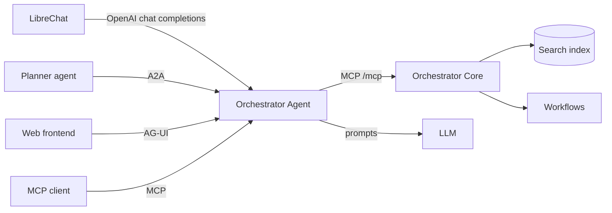

# How it works

The Orchestrator Agent is a thin service on top of Orchestrator Core. It holds no search index and no domain logic of
its own. It is an LLM agent, built with [pydantic-ai](https://ai.pydantic.dev/), that calls the tools of the MCP
server of Orchestrator Core and turns the results into answers.

## Request flow

Every protocol is an adapter in front of the same agent. For each request the agent opens an MCP session to
Orchestrator Core, lets the model call tools, and returns the answer in the format of the protocol. The model of the
LLM is chosen with `AGENT_MODEL`, see [Use your own LLM](../guides/own-llm.md).

## Orchestrator Core: search index and MCP server

The search infrastructure lives in Orchestrator Core: the query engine, filters, retrievers, indexing and the database
models. The MCP server of Orchestrator Core exposes it, together with the workflow and subscription operations, as
tools. See [AI / Hybrid Search](https://workfloworchestrator.org/orchestrator-core/reference-docs/ai-search/) and the
[MCP server](https://workfloworchestrator.org/orchestrator-core/reference-docs/mcp/).

Because of this split, the descriptions of the tools in Orchestrator Core carry how a tool is used: how to filter, which
operators exist and in what order to discover them. The prompts of the agent only describe intent. The model
binds *run the search* to the search tool from its description. This is "fat tools, thin prompts".

At startup the agent lists the tools of the live server and stops with an error if a tool that its code depends on
is missing. A rename in Orchestrator Core is therefore noticed at once, instead of silently breaking the output.
An unreachable server is logged as a warning.

### Find the exposed tools

Every tool is a REST route of Orchestrator Core with the tag `agent-exposed`. The API docs of your orchestrator show
them in that group, at `http://<core>/api/docs#/agent-exposed`. For each route you see the name of the tool (the
`operationId`), the description the model reads (the docstring) and the parameters.

The default set is listed in the [MCP server reference](https://workfloworchestrator.org/orchestrator-core/reference-docs/mcp/#usage). To add
a tool of your own, see [Give the agent your own tools](../guides/own-tools.md).

## Read tools and write tools

Most tools only read: search, aggregate, look up an entity. Orchestrator Core also exposes tools that can make
changes: `create_workflow`, `resume_workflow_process` and `abort_workflow_process`.

These write tools are part of the MCP server of Orchestrator Core, so any MCP client that connects to it directly
can call them. The Orchestrator Agent deliberately does not: it never gives them to the model. It starts workflows
through a separate, approved path instead, described in [Why workflows need approval](#why-workflows-need-approval).

!!! danger "Connecting the write tools yourself"
    You can still connect these tools to your own agent or MCP client, at your own discretion. We do not advise it:
    the model can then change your inventory without the approval of a person. If you do, let the client ask for
    confirmation before each call. The tools carry hints for this: `abort_workflow_process` is marked destructive,
    and none of the three is marked read-only.

## Plugins and guards

A [plugin](../reference/plugins.md) is a Markdown file with a prompt and a few lines of frontmatter. It declares the
tools it owns and, optionally, how their results are shown. The built-in plugins are search, aggregate, entity,
export and workflow. Each one becomes a capability of the agent and a skill in the A2A agent card.

Ownership of a tool drives two things. The results of the tool are mapped to the declared output type: a query result
for a table or chart, a data result for one entity, or an export. And when a plugin is set to load on demand, its
tools stay hidden together with its instructions until the model loads it. Tools owned by no plugin are always
available.

A few guards hold for all tools, so they are not part of a plugin:

- The **filter path guard** requires that a call with filters or a grouping is preceded by the discovery of the valid
  filter paths. Paths are specific to a database and must not be guessed.
- The **write tool gate** hides the write tools of Orchestrator Core from the model, see below.
- **History trimming** keeps a sliding window of the conversation.

Tables and charts are **rendered blocks**: the agent builds a Markdown table or a Mermaid chart from the result in code
and adds it to the answer. The model only summarises, so the numbers and rows are not retyped by a model, and they
appear on clients that only show text.

## Why workflows need approval

A user can ask the agent to *create a port for customer X*. That request needs one of the write tools above, and a
model can pick the wrong workflow, fill in a value nobody gave, or read *sure* as consent. So the model never calls a
write tool. The [write tool gate](#plugins-and-guards) removes them from its toolset, and the
[workflow plugin](../reference/plugins.md#workflow) only lets it choose which workflow to start. A deterministic
form-fill skill does the rest, and a person answers it:

1. **Route.** The model decides that a request starts a workflow and which one, from the list of workflows, and hands
   over with the key of the workflow.
2. **Walk the form.** The skill fetches the form page by page from Orchestrator Core, using the answers so far. Pages
   are dynamic, so the walk starts again from the first page every turn.
3. **Ask.** At the first page that Orchestrator Core does not accept, the person gets one question per field, with
   the options as choices. Consent fields are only ever accepted by an explicit answer of the person.
4. **Confirm.** When the form is complete, the person approves the exact call that will be made. Approve starts the
   workflow and reject cancels it.
5. **Start.** The skill makes the call with exactly the validated pages. A start is sent once per approval.

No chat text is read as an answer: a person who types *yes* has not approved anything. The questions and the approval
travel as native pauses of the protocol, which is the human-in-the-loop extension of kagent over A2A, and the ask-user
tool of LibreChat. The agent never judges a value. Orchestrator Core validates every page, and the agent only
interprets what a person typed in words into a value, which Orchestrator Core validates again.

The MCP and AG-UI endpoints run without this skill, so they have neither the workflow plugin nor the write tools.

## Where your data goes

- **To the LLM.** The prompts, the tool results of Orchestrator Core that the model has to read, and the history of the
  conversation go to the provider you set in `AGENT_MODEL`. Use a self-hosted model when this data may not leave your
  network, see [Use your own LLM](../guides/own-llm.md).
- **To Orchestrator Core.** The tool calls, with the token of the user when authentication is on.
- **To the embedding provider.** Not by the agent. Embeddings are made by Orchestrator Core, see
  [Enable AI search and embeddings](../guides/ai-search.md).
- **To Langfuse or any other observability platform.** Only when you enable it, and then the traces contain the
  prompts and tool results. See
  [Security and observability](../guides/security-observability.md).

The agent keeps the memory of a conversation and its open form per conversation id, and it holds no other data of
its own.
